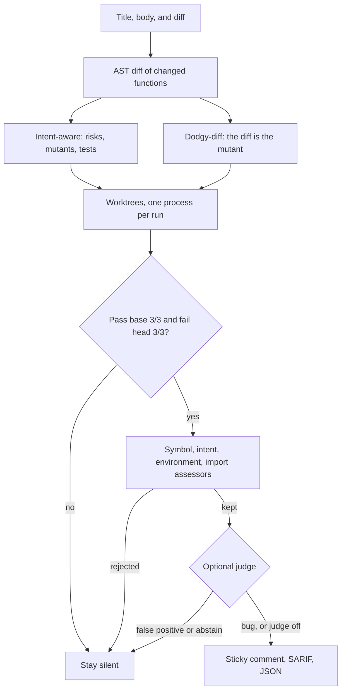
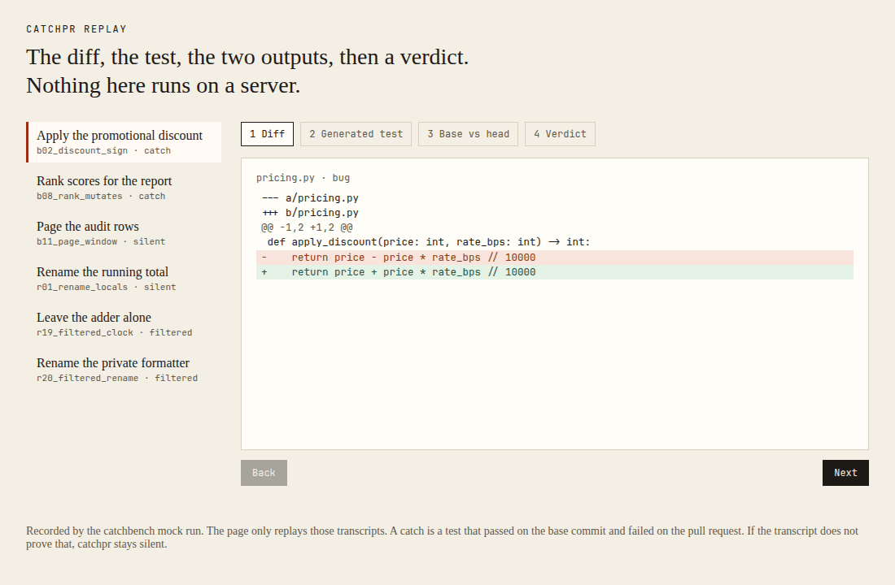

# catchpr

[](https://github.com/kfairy9999/catchpr/actions/workflows/ci.yml)

**Live replay playground:** https://catchpr.kfairley9999.workers.dev

catchpr comments on a pull request only when it has a generated test that passes on the base commit and fails on the head, every time it is run, and a one-line command that reproduces that result. If it cannot prove a behavior change, it stays silent.

That is the opposite of a review bot that reads the diff and writes remarks. Those tools are regularly criticized for noise. [Greptile's public benchmark](https://www.greptile.com/benchmarks) is a useful picture of that style of evaluation: it scores whether a reviewer names a known bug. It does not score false positives. catchpr is built around the false-positive problem. A comment is a failing test, not a suspicion.

The technique follows Meta's just-in-time catching test generation, reported in Becker et al., *Just-in-Time Catching Test Generation at Meta*, FSE 2026 ([arXiv:2601.22832](https://arxiv.org/abs/2601.22832)), and described from the production side in [Catching bugs before they land](https://engineering.fb.com/2026/10/29/security/catching-bugs-before-they-land-jittestings-human-on-the-loop-approach-at-full-scale/). A catching test is meant to fail on the proposed change and pass on its parent. Meta's paper distinguishes a weak catch (the test does that) from a strong catch (the failure is a real bug). v0.1 produces weak catches and then applies deterministic assessors. It does not claim Meta's production rates. Those are cited below as the paper's results, not as measurements of this repository.

## How it works

Two generators, both diff-aware, as in the paper:

- **Intent-aware.** The model reads the title, the body, and the diff, states the intent, lists ways that intent could be implemented wrongly, and turns each risk into a mutant of the parent. It then writes a pytest that should pass on the parent and fail on that mutant. The mutant is applied to a scratch copy of the base and executed. A test that does not kill its mutant is discarded.
- **Dodgy-diff.** The diff itself is the mutant. The model writes tests that pass on the parent and fail if the diff's behavior is present. No intent is assumed.

A candidate is a catch only when it passes on the base 3/3 and fails on the head 3/3. Anything flaky is dropped. Surviving failures go through assessors: a missing or renamed symbol, a change the pull request text declares, dependence on time or randomness or the environment, and import errors. An optional LLM judge can run after those rules. It is off unless you pass `--judge`. Abstaining or calling the failure a false positive keeps the tool silent.



The comment includes the test, the base output, the head output, and one command:

```text
catchpr repro --repo . --base <base-sha> --head <head-sha> --test-b64 <test>
```

## Quickstart

Python 3.10 or newer. The package is not published to PyPI. Install it from GitHub:

```bash
python -m pip install "git+https://github.com/kfairy9999/catchpr.git"
```

Or from a local checkout (with dev tools and the benchmark harness):

```bash
python -m pip install -e ".[dev]"
python -m catchbench --ids b02_discount_sign --repeats 1 --workers 1 --output /tmp/one.json
```

That replays one recorded bug. The sandbox is real: the generated test is executed on both commits. On a repository of your own, with no recordings and therefore no model calls, the default provider stays silent:

```bash
python -m catchpr run \
  --repo . \
  --base origin/main \
  --head HEAD \
  --title "Apply the promotional discount" \
  --body "Subtract the basis-point rate from the price." \
  --json catchpr-results.json \
  --sarif catchpr.sarif \
  --comment catchpr-comment.md
```

Exit codes:

| Code | Meaning |
| --- | --- |
| 0 | Finished. No validated catch. |
| 1 | Finished. At least one validated catch. |
| 2 | Bad invocation. |
| 3 | The tool failed. |

`--report-only` exits 0 even when there is a catch, which is what the GitHub Action uses. The signal there is the comment, not a red check. Omit the flag when you want CI to fail on a catch.

Providers:

| Name | When |
| --- | --- |
| `mock` | Default. Replays recordings. Unknown prompts return an empty payload, and the run stays silent. |
| `groq` | OpenAI-compatible API at `api.groq.com`. Reads `GROQ_API_KEY`. `--model` overrides `llama-3.3-70b-versatile`. |
| `openai` | Any OpenAI-compatible server. `--base-url` and `--api-key-env` (default `OPENAI_API_KEY`). |

HTTP providers throttle, retry on 429 using `Retry-After` or exponential backoff, and cache completions on disk. `--no-cache` disables the cache. Keys are read from the environment and are not written into reports.

## GitHub Action

The job that runs the pull request has `contents: read` and no secrets. A second workflow, triggered by `workflow_run`, posts the comment and does not execute the pull request or the generated test. `pull_request_target` is not used. Actions are pinned to commit SHAs.

Untrusted job, `.github/workflows/catchpr.yml`:

```yaml
permissions:
  contents: read
```

Trusted job, `.github/workflows/catchpr-comment.yml`: checks out the default branch, downloads the artifact, rebuilds the markdown itself, and takes the pull request number from the `workflow_run` event rather than from the artifact. If nothing was proved, an existing sticky comment is deleted.

`action.yml` is the composite action for the run step. It does not take a token. Do not put `GROQ_API_KEY` or `OPENAI_API_KEY` in the `pull_request` job. The code under test can read the environment. Live models belong in a trusted context. See [SECURITY.md](SECURITY.md).

## Benchmark

[catchbench](catchbench/cases.py) is 40 small Python libraries. Twenty seed a realistic behavior bug. Twenty are behavior-preserving refactors, including two where a careless test would look like a catch (a call to `random`, and a test that imports a private name the diff renamed). The probes in that file are the ground truth for "this case changes behavior." They are not the tests catchpr runs.

The published run is mock mode. `MockProvider` replays a recorded test and a recorded read-only review for each case. The sandbox, the 3/3 gate, and the assessors are executed for real. The read-only column is the recorded verdict, scored by the harness. It is not a measurement of any live model. `api_cost_usd` is 0 because no API was called. No live-model numbers are published in this repository. `python -m catchbench.live` will call Groq or another OpenAI-compatible server and write `catchbench/results/live.json`, which is gitignored.

Numbers below are from [catchbench/results/mock.json](catchbench/results/mock.json), produced by `python -m catchbench --repeats 3 --workers 4`.

| | catchpr, mock recordings | read-only review, same recordings |
| --- | ---: | ---: |
| Bug catch rate | 80% (16/20) | 70% (14/20) |
| False alarms on harmless diffs | 0% (0/20) | 30% (6/20) |
| Comments per PR | 0.40 | 0.50 |
| Estimated prompt tokens | 31,477 | included |
| Remote API calls | 0 | 0 |
| API cost | $0.00 | $0.00 |
| Wall time of this run | 121.9s | included |

The four misses (`b11_page_window`, `b14_order_id`, `b16_keep_evens`, `b20_tag_counts`) are seeded bugs whose recorded test checks a behavior the bug does not change: the first element of a page, an already-lowercase id, an empty list, an empty tag map. The gate correctly stays silent. That is a miss, and it is what an execution gate is for.

Two harmless diffs produced a candidate failure and were not commented on. `r19_filtered_clock` included a test that calls `random`. `r20_filtered_rename` imported a private function the diff had renamed, and the symbol assessor dropped the `ImportError`. The read-only recordings flag 6 of the 20 refactors anyway. Those verdicts were written as fixtures so the harness has a noisy reviewer to score. They are not evidence about a particular model.

Greptile's July 2025 benchmark, linked above, reports catch rates for review bots on 50 known bugs and states that false positives did not affect the score. catchbench is not a comparison against those tools and does not reuse their tasks. It only exists so this repository can report a false-alarm rate next to a catch rate.

`python -m catchbench.compare catchbench/results/mock.json fresh.json` checks that a new mock run comments on the same cases. It ignores wall time.

## Demo

Live interactive replay: [catchpr.kfairley9999.workers.dev](https://catchpr.kfairley9999.workers.dev).



[docs/media/demo.gif](docs/media/demo.gif) is the recorded replay: diff, generated test, base against head, verdict.

The same page is a single Cloudflare Worker with the HTML embedded and no bindings, so it costs nothing to serve and runs no tests on the server.

```bash
python demo/build.py
cd demo
npx wrangler deploy --dry-run
```

`wrangler deploy --dry-run` bundles the Worker and exits without deploying. The dry run reports no bindings.

## Limitations

- Python only, and pytest only. The runner puts the worktree on `PYTHONPATH` and executes one generated file. It does not install the project's dependencies.
- v0.1's assessors are a small deterministic subset of the paper's rule assessor, plus one optional judge. They are not the paper's ensemble, and they are not a proof that a failure is a bug.
- A public rename, a new required argument, or an intentional behavior change that the pull request text does not describe can still produce a comment. The comment is a question about the behavior change.
- `NotImplementedError`, timeouts, and import errors are treated as non-bugs. A real bug that surfaces only as an import error will be missed.
- The sandbox limits CPU, address space, file size, and network. It is not a boundary against a malicious pull request author: in CI that author can already execute code. The protection against secret theft is the split workflow, not the `setrlimit` calls. Details are in [SECURITY.md](SECURITY.md).
- The mock benchmark measures this pipeline on hand-written recordings. It does not measure a model. Until you run `python -m catchbench.live`, there is no live number to quote, and this README does not invent one.
- The paper's own figures, for scale only: on 22,126 generated tests, diff-aware workflows produced about 4× the weak catches of hardening tests and about 20× a coincidental-failure baseline; the assessors cut human review load by about 70%; 8 of 41 engineer reach-outs were confirmed, 4 of them serious. Those numbers are Meta's, from the paper, on Meta's code. They are not catchpr's.

## How it was built

v0.1 was written from scratch against the two workflows in section 3 of the paper. Intent-aware code infers intent, lists risks, materializes each risk as a mutant of the parent, and asks for a test that kills it. Dodgy-diff skips the intent and treats the diff as the mutant. Both then face the same gate: pass on the parent, fail on the child, stable across repeats, and not rejected by an assessor. The generators talk to a provider interface so the same runner drives recordings, Groq, or any OpenAI-compatible server. The benchmark's published table was produced by running that runner, not by filling in a spreadsheet. The Worker was generated from those transcripts with `python demo/build.py`.

## Development

[CONTRIBUTING.md](CONTRIBUTING.md) has the commands for ruff, mypy, pytest, and the benchmark. [CHANGELOG.md](CHANGELOG.md) starts at 0.1.0. The license is [MIT](LICENSE).
