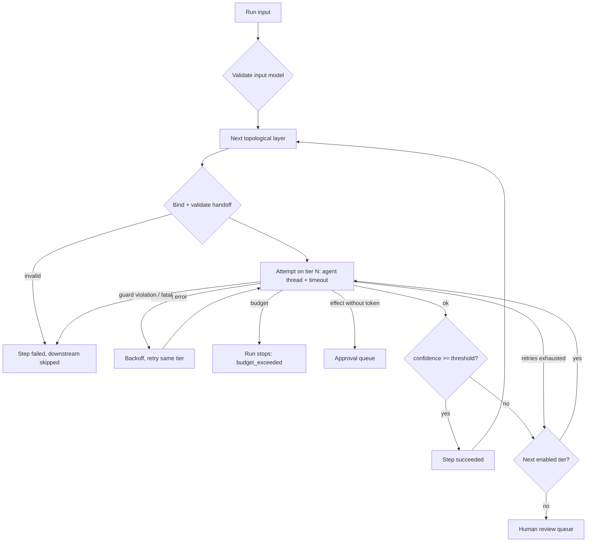

# catchpr.orchestra

A reliability layer for typed multi-agent pipelines. It runs a DAG of agents,
checks every handoff against pydantic schemas, retries with backoff, enforces
timeouts and run budgets (tokens, dollars, wall-clock), routes low-confidence or
failed steps up a model ladder and then to a human, refuses side effects without
a signed human approval, and writes a hash-chained audit log that can be
verified and replayed offline.

It ships inside the catchpr repository as an optional subpackage. catchpr's PR
test generator does not depend on it.

Status: works end to end against DeepInfra and against the real `coi_agents`
and `leadflow_sales` team code (see "Evidence" below). It is new. It has not
run in production, and it has not been load-tested. The Claude rung is
implemented but disabled; it has only been tested against a local stub server.

## Install

```bash
python -m pip install -e ".[orchestra]"     # pydantic + cryptography
python -m pip install -e ".[dev]"           # adds test, lint, and type tools
```

## Two-minute tour

```bash
catchpr-orch tiers                 # the model ladder, and which API keys are present
catchpr-orch demo coi --html       # stub COI team, mock provider, synthetic data
catchpr-orch demo coi --provider deepinfra --max-usd 0.02   # same, live models
catchpr-orch trace runs/<run-id>   # terminal trace; --html FILE for a page
catchpr-orch verify runs/<run-id>  # recompute the hash chain and every blob
catchpr-orch replay runs/<run-id>  # re-run offline from recorded responses
```

The COI demo ends `awaiting_approval`: the reviewer wants to email the vendor,
and no human has approved that email. To approve it:

```bash
catchpr-orch keys init                       # once; the private key stays with the approver
catchpr-orch approve runs/<run-id> <item-id> --approver "Kevin" --tokens approvals.json
catchpr-orch resume runs/<run-id> --approvals approvals.json
```

`approve` prints the exact action, recipient, and payload and asks you to type
`approve`. The demo's `email.send` executor writes a JSON file to
`runs/outbox/`. It never contacts a mail server.

Exit codes for `run`, `demo`, and `resume`: 0 succeeded, 10 needs review,
11 awaiting approval, 12 failed, 13 budget exceeded, 2 usage or config error.

## Architecture



| Module | Responsibility |
| --- | --- |
| `pipeline.py` | `Step`, `Pipeline`, `RetryPolicy`. Static checks at construction: unknown or cyclic dependencies, multi-input steps without a `bind`, default handoffs whose target model needs fields the source lacks, confidence thresholds without a confidence source. |
| `agents.py` | The adapter (`adapt`, `load_agent`), `AgentContext`, and the metered `LLMClient` (`ctx.llm.complete`, `complete_json`, `call`). |
| `engine.py` | `Orchestrator`: layers, parallelism, attempts, timeouts, retries, escalation, review and approval queues, `resume`. |
| `budget.py` | Reserve-then-settle accounting in `Decimal`. |
| `tiers.py`, `pricing.py` | The model ladder and per-model prices. Unpriced models are refused. |
| `providers.py` | DeepInfra (OpenAI-compatible), Anthropic, mock, and replay providers. Text and image inputs. |
| `guard.py` | Ed25519 approval tokens, the effect gate and ledger, and the network/process tripwire. |
| `audit.py` | Hash-chained JSONL log, content-addressed blobs, `verify_run`. |
| `replay.py`, `trace.py`, `cli.py` | Offline replay, terminal/HTML traces, the `catchpr-orch` CLI. |

### Typed handoffs

Each step declares an agent whose input and output are pydantic models. A step
with no dependencies receives the run input; a step with one dependency receives
that output; a step with several needs a `bind(Handoff) -> input`. Whatever the
source, the value is validated against the agent's input model before the agent
runs. A failed handoff is deterministic, so it is not retried: the step fails
and its dependents are skipped. Agent output is validated against the output
model; a wrong type or shape is a retryable `OutputValidationError`, because it
usually comes from model output.

### Retries, timeouts, budgets

* `RetryPolicy` is per tier: exponential backoff with bounded jitter. A
  provider's `Retry-After` header wins, capped at `max_delay`.
* Each attempt runs in its own thread and is abandoned when `timeout_s` passes.
  Python cannot kill a thread, so the context is cancelled instead: any later
  `ctx.llm` or `ctx.effect` call from the abandoned attempt raises `Cancelled`,
  and a response that arrives late is discarded (it is still charged).
* Before every model call the budget reserves the worst case (a conservative
  prompt estimate of about 3 characters per token, plus about 3,000 tokens per
  image, plus `max_tokens` of output). If that could cross the token or dollar
  cap, the call is refused before any request is sent, and the run stops with
  `budget_exceeded`. Afterwards, the reservation is replaced by the usage the
  provider reports. A network failure that may have reached the provider is
  charged the full reservation. If real usage exceeds the reservation (prompt
  tokenized larger than the estimate), it is charged in full and counted under
  `overshoots` in the summary, so the cap can be exceeded only by that
  estimation error.
* The wall-clock budget is checked before every attempt and bounds each
  attempt's timeout.

### Confidence routing

A step with `min_confidence` reads the score from an output field named
`confidence`, or from `confidence_of(output)` when the team's schema has none.
An exception in `confidence_of` scores 0, which fails closed. A low score
escalates immediately; re-asking the same model at temperature 0 rarely
changes the answer. The step then moves to the next enabled tier. Exhausted
retries also escalate. Disabled rungs are skipped and logged with their reason.
When nothing is left, the step goes to the review queue with its best candidate
output, or fails if `on_exhausted="fail"`.

Default ladder (prices from the DeepInfra catalog snapshot of 2026-11-22, USD
per 1M input/output tokens; confirm them before relying on dollar caps):

| Tier | Model | Price in/out |
| --- | --- | --- |
| fast | meta-llama/Meta-Llama-3.1-8B-Instruct-Turbo | 0.02 / 0.04 |
| standard | meta-llama/Llama-3.3-70B-Instruct-Turbo | 0.10 / 0.32 |
| strong | deepseek-ai/DeepSeek-V3.2 | 0.26 / 0.38 |
| claude | claude-sonnet-4-5 (Anthropic) | **disabled until an Anthropic key is approved** |

To enable the Claude rung later, pass `--tiers tiers.json` with
`{"name": "claude", "provider": "anthropic", "model": "...", "enabled": true,
"usd_per_m_input": ..., "usd_per_m_output": ...}` and set `ANTHROPIC_API_KEY`.
Without both a price and a key it refuses to start. There is no default Claude
price on purpose.

Provider selection: `--provider auto` (the default for `run`) uses DeepInfra
when `DEEPINFRA_API_KEY` or `DEEPINFRA_TOKEN` is set. Otherwise it uses the mock
provider and writes a note into the run saying tokens and dollars are
simulated. `demo` defaults to the mock provider with scripted answers.

### Side effects need a human approval token

Agents cause outbound effects only through `ctx.effect(action, target, payload)`
or `ctx.effects([...])` for a batch. The gate executes an effect only if all of
these hold:

1. A token is signed by the approver's Ed25519 private key. The orchestrator
   holds only the public key, so agent code and model output cannot mint one.
2. The token's action, target, and SHA-256 of the canonical payload match
   exactly. A changed word in the email body needs a new approval.
3. The token is unexpired (default TTL one hour), and its nonce has not been
   spent.
4. A trusted executor is registered for the action. An unknown action is
   refused even with a valid token.

The nonce is written to an flock-protected ledger before the executor runs, so
a crash mid-send cannot lead to a second send (at most once). Executed requests
are recorded, so a retry, a resume, or another run with the same payload is
deduplicated instead of sent again. Without a token, the step stops in
`awaiting_approval` and the queue item carries the full payload for the
approver to read.

**Network/process tripwire.** While agent code runs, a `sys.addaudithook`
hook refuses socket connects, DNS lookups, and process spawns unless they come
from the metered model client or a trusted executor. A violation fails the step
even if the agent catches the exception. Per step, `allow_subprocess=True` (OCR)
or `allow_network=True` can opt out. This is a tripwire, not a sandbox: native
extensions, `ctypes`, or threads the agent starts itself can get around it.
Real isolation needs a separate process or container.

### Audit log and replay

`runs/<run-id>/` contains:

* `audit.jsonl`: one event per line (`run_start`, `step_start`,
  `attempt_start`, `llm_call`, `llm_error`, `attempt_ok`, `attempt_error`,
  `low_confidence`, `escalate`, `tier_skipped`, `approval_required`,
  `effect_executed`, `review_queued`, `step_override`, `step_end`, `run_end`).
  Each event has the model, tier, provider, input and output tokens, cost,
  latency, and SHA-256 references for inputs, outputs, requests, and responses.
  Each record carries `prev` and `hash`, which form a chain.
* `blobs/<sha256>.json` (mode 0600): the referenced payloads. Use
  `--no-payloads` to keep hashes only; replay and resume then become unavailable.
* `summary.json`: per-step status, digests, cost, and the chain's head hash.
* `review.jsonl`, `resolutions.json`, `trace.html`.

`verify` recomputes every record hash, the chain, the sequence numbers, and
every blob. The chain uses no key, so it detects edits, deletions, reordering,
and truncation. It does not stop someone who rewrites the whole file and
recomputes every hash. For that, store the head hash from `summary.json`
somewhere else, such as a commit, a ticket, or an email.

`replay` runs the current pipeline code on the recorded input. Model calls are
answered from recorded responses by request digest, and effects from recorded
results. Nothing goes over the network and nothing is executed. It then
compares every step's status and output digest. A mismatch means code, prompts,
or the pipeline changed since the run. Output fields that legitimately vary
between identical runs, such as timings, are listed in `Step.volatile_fields`
and excluded from the compared digest. Blobs keep the original key order, so
agents that iterate over mappings see the same order on replay.

### Human review and resume

```bash
catchpr-orch review list
catchpr-orch review resolve runs/<run-id> <item-id> --output fixed.json --reviewer Kevin
catchpr-orch resume runs/<run-id> [--approvals approvals.json]
```

`resolve` validates the human output against the step's output model. `resume`
starts a new run linked by `parent_run`. Finished steps and human resolutions
are reused (recorded as `resumed:<run>` or `human:<name>`). Steps that were
waiting on approval run again, and the effect ledger deduplicates anything
already sent.

## Agent adapter interface

Any of these plug in unchanged:

```python
def run(inp: InModel) -> OutModel: ...                     # pure
def run(inp: InModel, ctx: AgentContext) -> OutModel: ...  # uses ctx.llm / ctx.effect
class Agent:
    def run(self, inp: InModel) -> OutModel: ...           # adapt(Agent(...).run)
def run(inp: InModel, provider=None) -> OutModel: ...      # extra args need defaults
```

`adapt(fn)` reads the models from type hints. Pass `input_model=` and
`output_model=` when the hints cannot be resolved, for example models defined
inside a function. The second parameter receives the context only if it is
named `ctx` or annotated `AgentContext`. Agents that do not take `ctx` can call
`catchpr.orchestra.current_llm()` or `current_context()`.

Model calls must go through the context (`ctx.llm.complete`, `complete_json`,
or `call` for multi-message, image, or pinned-model requests) to be metered,
audited, budgeted, and replayable. `call(model=...)` pins a priced model, such
as a vision model. A pinned model does not change when the step escalates.

```python
from catchpr.orchestra import Orchestrator, Pipeline, Step, adapt, BudgetLimits, build_tierset

pipeline = Pipeline("my-team", MyInput, (
    Step("a", adapt(agent_a)),
    Step("b", adapt(agent_b), after=("a",), min_confidence=0.8, start_tier="fast"),
))
orch = Orchestrator(pipeline, build_tierset(), runs_dir=Path("runs"),
                    limits=BudgetLimits(max_usd=Decimal("0.10")))
result = orch.run({...})
```

## Wiring in the COI and LeadFlow agents

Both teams already expose typed `run(input) -> output` agents. The wiring lives
in `catchpr/orchestra/integrations/` and imports the team packages lazily, so
catchpr does not depend on them.

### COI back-office (`/workspace/coi-agents`)

```python
import os
os.environ["COI_AGENTS_VAR"] = "/path/to/scratch"   # team caches and inbox
from catchpr.orchestra.integrations import coi_agents as wiring

job = wiring.job_from_pdf(Path("cert.pdf"), Path("requirements.json"))  # team intake
orch = Orchestrator(wiring.build(), build_tierset(), runs_dir=Path("runs"),
                    limits=BudgetLimits(max_usd=Decimal("0.05")),
                    pipeline_ref="catchpr.orchestra.integrations.coi_agents:build")
orch.run(job)
```

One run handles one certificate: extractor, then checker, then reviewer.
Intake (a folder or a mailbox of documents) is a batch step. Run it first, and
start one catchpr run per document.

* `CatchprCoiProvider` implements the team's `LLMProvider`, so every extractor
  call is metered and audited. Text calls use the tier model, so escalation
  works; `build(text_model_policy="agent")` keeps the team's own text model
  instead. Vision calls for scanned pages keep the team's vision model, which
  must be priced.
* The extractor step allows subprocesses (Tesseract OCR); network stays blocked.
* Routing: validator flags left after the cross-check score 0.5 and escalate.
  A reviewer decision of `human_review` goes to catchpr's review queue with the
  reviewer output attached.
* The team's extractor keeps an on-disk model-response cache under
  `COI_AGENTS_VAR`. A cache hit makes no model call, so it is not metered as an
  `llm_call`. Use a fresh `COI_AGENTS_VAR` when every call must be metered.
* Never point evaluation runs at the Nov 29 holdout set.

### LeadFlow sales (`/workspace/leadflow-sales-agents`)

```python
from catchpr.orchestra.integrations import leadflow_sales as wiring
orch = Orchestrator(wiring.build(), build_tierset(), runs_dir=Path("runs"),
                    pipeline_ref="catchpr.orchestra.integrations.leadflow_sales:build")
orch.run({"prospect": {"agency_name": "...", "email": "...", "city": "...", "state": "CA"},
          "gmail_sent_path": "/path/to/gmail-sent-export.json"})
```

The pipeline is researcher, then writer, then compliance, then scheduler. The
team is draft-only by construction. A compliance verdict of `block` (for
example, no Gmail Sent export to check against) goes to catchpr's review queue,
and the scheduler is skipped. Sending a draft is deliberately not wired. When
it is added, it must be a separate step that calls `ctx.effect("email.send",
...)`, so it needs Kevin's signed approval of the exact message.

Environment: put the team packages on `PYTHONPATH`, or install them. When you
run catchpr's own test suite with both teams on the path, put the catchpr
checkout first, because `coi-agents` also has a top-level `tests` package:
`PYTHONPATH=/workspace/coi-agents:/workspace/leadflow-sales-agents/src pytest
tests/test_orch_integrations.py`.

## Evidence

* Tests: `tests/test_orch_*.py` cover handoffs, retries and backoff, `Retry-After`,
  timeouts with late calls refused, dollar, token, and wall-clock caps (no
  request sent once over), escalation and skipping the disabled Claude rung,
  review and resume, approval tokens (forged, tampered, expired, wrong payload,
  spent nonce, crash mid-send, missing executor), batch approvals, the network
  and process tripwire, audit tampering (edit, delete, truncate, corrupt or
  missing blob), replay match and mismatch, HTTP error mapping against a local
  stub server, HTML escaping, and the CLI. A seeded fault-injection loop checks
  that random transient failures never push spending past the cap, never leave
  money reserved, and never break the audit chain.
* `sample-trace-live-deepinfra.txt` and `.html`: a live DeepInfra run of the
  stub COI team with the extractor threshold raised to 0.95
  (`escalate_live.py`). It shows a schema failure and retry on the 8B model,
  escalation 8B to 70B to DeepSeek-V3.2, and the email held for approval.
  Total $0.00016. Replayed offline: MATCH.

## Limitations

* Single process. Parallel steps share one process and one budget lock. There
  is no distributed queue.
* A timed-out attempt's thread keeps running until it returns; its output is
  discarded. CPU-bound agents that never return keep using a core.
* The network/process guard is a tripwire, not isolation.
* Replay assumes agents are deterministic given model responses, apart from
  declared volatile fields.
* Prices are a snapshot. Dollar caps are only as accurate as the price table
  and the provider's reported usage.
* The stub LeadFlow researcher (`examples/leadflow.py`) is a template, not a
  research tool. In one live run against a real 70B model it returned
  plausible-looking agency contact emails that were never verified and should
  be treated as invented. No such output is committed here, and nothing was
  queued or sent (compliance rejected every draft). Never use model-generated
  contact data; the real LeadFlow researcher works from supplied prospect data.
